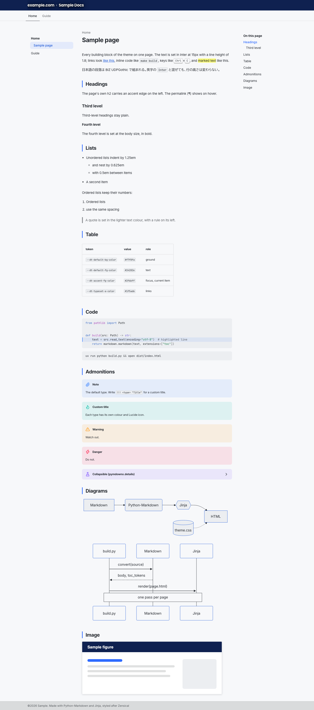

# Docs theme standard

The look of a [Zensical](https://zensical.org/) docs site (theme variant `modern`, with the site palette on
top), rebuilt for plain **Python-Markdown + Jinja** output. Use it when a page must look like the docs site
but is not built by Zensical: a generated report, a tool's HTML output, a small static site.

One gate: **`make check`** (ruff, pyright, then a build).

Values below are measured from Zensical 0.0.67 (`zensical/templates/assets/stylesheets/modern/main.*.min.css`
and `javascripts/bundle.*.min.js`) and from the site's override stylesheet. Re-measure when Zensical changes.

## Template

`template/` is a working site: three pages, one of which shows every building block.



```bash
NAME=my-docs
cp -R ~/repo/dev-kit/docs-theme/template ~/repo/$NAME
cd ~/repo/$NAME
git init && make check
make serve         # http://localhost:8000 (Mermaid is an ES module: open over HTTP, not file://)
```

| file | role |
|---|---|
| `build.py` | `content/**/*.md` → `dist/**/*.html`. Top-level dirs become tabs; links are relative; `.md` links to pages become `.html` |
| `site.toml` | site name, language, copyright line, optional parent link, tab titles |
| `templates/base.html` | page frame: header band, tabs, left navigation, "On this page", footer |
| `templates/page.html`, `toc.html` | breadcrumb + article; the table of contents |
| `static/theme.css` | every token and rule (below) |
| `static/theme.js` | copy button, table-of-contents tracking, header shadow, back to top |
| `static/mermaid.js` | Mermaid in the theme's colours |
| `content/` | sample pages |

To restyle only, keep the markup and change the tokens at the top of `theme.css`.

## Markdown

Same extensions and options as the Zensical site, plus `pymdownx.details`:

```python
EXTENSIONS = ["admonition", "attr_list", "md_in_html", "tables", "toc",
              "pymdownx.details", "pymdownx.highlight", "pymdownx.superfences"]
EXTENSION_CONFIGS = {
    "toc": {"permalink": True},
    "pymdownx.superfences": {"custom_fences": [
        {"name": "mermaid", "class": "mermaid", "format": fence_code_format}]},
}
```

The theme styles what these emit, inside `.prose` (Zensical's `.md-typeset`):

| source | HTML | styled by |
|---|---|---|
| `## Title` (toc permalink) | `<h2 id>…<a class="headerlink">¶</a></h2>` | `.prose h2`, `.headerlink` (shows on hover) |
| ```` ```py hl_lines="2" ```` | `div.highlight > pre > code`, Pygments `span.k` …, `span.hll` | `.prose .highlight .<token>` (table below) |
| ```` ```mermaid ```` | `pre.mermaid > code` | replaced by `static/mermaid.js` |
| `!!! note "T"` | `div.admonition.note > p.admonition-title` | `.prose .admonition.<type>` |
| `??? note` / `???+` | `details.note > summary` | same as admonitions, plus a chevron |
| plain table | `table` without a class | `.prose table:not([class])` |

`toc_tokens` from the `Markdown` instance feeds "On this page": the single h1 is the page title; its h2 and h3
children are listed.

## Tokens

Names are Zensical's with `--dt-` for `--md-`, so each can be found in the theme's CSS.

### Colour

| token | value | Zensical default | note |
|---|---|---|---|
| `--dt-default-bg-color` | `#f7f8fa` | `#fff` | ground |
| `--dt-default-fg-color` | `#24282e` | `#000000de` | text |
| `--dt-default-fg-color--light` | `rgba(36,40,46,.72)` | `#0000008c` | secondary text, quote |
| `--dt-default-fg-color--lighter` | `rgba(36,40,46,.5)` | `#00000052` | permalink, scrollbar |
| `--dt-default-fg-color--lightest` | `rgba(36,40,46,.14)` | `#0000000d` | hairlines, hover fill, footer |
| `--dt-accent-fg-color` | `#2f6bff` | `#526cfe` | focus, hover, current heading, h2 edge |
| `--dt-accent-fg-color--transparent` | `rgba(47,107,255,.1)` | `#526cfe1a` | current page fill |
| `--dt-typeset-a-color` | `#1f5ad6` | primary `#4051b5` | links, current page text |
| `--dt-code-bg-color` | `#eceef1` | `#f5f5f5` | inline code and blocks share it |
| `--dt-code-fg-color` | `#24282e` | `#36464e` | |
| `--dt-band-color` / `--dt-band-fg-color` | `#0f2150` / `#f0f0f0` | (none) | header band; Zensical draws the header on the ground, blurred |
| `--dt-band-image` | `none` | (none) | optional photo, drawn at 12% opacity in luminosity blend |
| `--dt-tab-fg-color` | `rgba(36,40,46,.6)` | text at `.7` opacity | tabs at rest; current tab full text, underlined |
| `--dt-typeset-mark-color` | `#ffff0080` | same | |
| `--dt-typeset-table-color` / `--light` | `#0000001f` / `#00000009` | same | borders / row hover |
| `--dt-typeset-kbd-border-color` | `#b8b8b8` | same | |

Syntax colours are Zensical's defaults:

| token | value | Pygments classes |
|---|---|---|
| `--dt-code-hl-keyword-color` | `#3f6ec6` | `k kd kn kp kr kt nd ni nl nt` |
| `--dt-code-hl-string-color` | `#1c7d4d` | `cpf l s s1 s2 sb sc si ss` |
| `--dt-code-hl-special-color` | `#db1457` | `cp se sh sr sx` |
| `--dt-code-hl-number-color` | `#d52a2a` | `il m mb mf mh mi mo` |
| `--dt-code-hl-function-color` | `#a846b9` | `nc ne nf nn` |
| `--dt-code-hl-constant-color` | `#6e59d9` | `bp nb no` |
| `--dt-code-hl-name-color` | code text | `kc n` |
| operator / punctuation / comment / generic / variable | text at `.72` | `o ow` / `p` / `c c1 ch cm cs sd` / `ge gh go gp gr gs gt gu` / `na nv vc vg vi` |
| `--dt-code-hl-color` / `--light` | `#4287ff` / at 10% | highlighted line: fill + 2px left edge |

Admonitions: the box is the type colour at 10% (`#rrggbb1a`), the icon the type colour at full strength, through
a CSS mask of a Lucide icon (inlined in `theme.css`).

| type | colour | icon | type | colour | icon |
|---|---|---|---|---|---|
| note | `#448aff` | paperclip | warning | `#ff9100` | triangle-alert |
| abstract | `#00b0ff` | notebook-text | failure | `#ff5252` | octagon-alert |
| info | `#00b8d4` | info | danger | `#ff1744` | zap |
| tip | `#00bfa5` | flame | bug | `#f50057` | bug |
| success | `#00c853` | check | example | `#7c4dff` | flask-conical |
| question | `#64dd17` | circle-question-mark | quote | `#9e9e9e` | message-square-quote |

Zensical 0.0.67 defines no aliases (`seealso`, `hint`, … get no colour).

### Type

`html { font-size: 125% }`: **1rem = 20px at every width** (Zensical goes to 137.5% at 100em and 150% at
125em; the site keeps it fixed so the header stays 48px).

| role | face | size |
|---|---|---|
| body (`.prose`) | Inter → BIZ UDPGothic for Japanese | `.75rem` (15px), line height 1.8, letter spacing −.01em |
| code | JetBrains Mono → BIZ UDPGothic | `.8533em` of the text; blocks line height 1.5 |
| site title | Poppins 700 | `.9rem` (18px), letter spacing −.025em, dark text shadow |
| tabs | Inter 500 | `.7rem` (14px) |
| navigation, breadcrumb, back to top | Inter | `.7rem` |
| tables | | `.64rem` |
| admonitions, footer | | `.64rem` |

| heading | size | weight | margin | other |
|---|---|---|---|---|
| h1 | 1.875em | 700 | 0 0 1.25em | line height 1.3, −.025em |
| h2 | 1.5em | 700 | 1.6em 0 .64em | line height 1.4, −.025em; 3px accent edge, .6em padding (site) |
| h3 | 1.25em | 700 | 1.6em 0 .8em (h2+h3: .8em top) | line height 1.5 |
| h4 | 1em | 700 | 1em 0 | |
| h5, h6 | .8em | 700 | 1.25em 0 | lighter text; h5 upper case |

Google Fonts: Inter 300/400/500/700 (+ italics), JetBrains Mono 400/700, Poppins 600/700, BIZ UDPGothic 400/700.

### Space and shape

| what | value |
|---|---|
| page width | `61rem` max, centred |
| header band, tab row | `2.4rem` (48px) each; header sticky, tabs scroll away |
| gap below the tabs | `1.5rem` |
| sidebars | `12.1rem` wide, `1.1rem` vertical padding, sticky below the header |
| content | `.8rem` side margin (`1.2rem` from 76.25em), `.7rem` top padding |
| lists | items `0 1.25em .5em`; nested lists `.5em .625em` |
| block spacing | `1em` above and below paragraphs, lists, blocks; admonitions `1.5625em` |
| code block | padding `.82em 1.25em`, radius 6px (site; Zensical `.4rem`) |
| inline code | padding `.2em .4em`, radius `.2rem`, 1px hairline at 12% text (site) |
| tables | cell padding `.9375em 1.25em`, radius `.1rem`, 1px border |
| admonitions | padding `0 .8rem`, radius `.4rem`, title icon `1rem` |
| navigation link | padding `.35rem .8rem` (table of contents `.2rem .6rem`), radius `.4rem`, gap `.2rem` |
| images in text | 1px border at 14%, radius 3px, `0 2px 8px` shadow at 12% (site) |
| shadows | `--dt-shadow-z1..z3` as Zensical |
| transitions | colour 125ms, navigation .25s |

### Breakpoints

| width | change |
|---|---|
| < 76.25em | tabs hidden; left navigation becomes a drawer (menu button, checkbox toggle, no JS) |
| ≥ 76.25em | both sidebars, tabs, wider content margin |
| < 60em | "On this page" becomes a floating button at the bottom right |
| < 45em | code blocks run to the screen edges, square corners |
| print | `.prose` at `.68rem`; chrome hidden; code wraps |

## Mermaid

Zensical does not use Mermaid's themes. It renders each block with `themeCSS` set to its own stylesheet, whose
rules read `--md-mermaid-*` custom properties, and puts the SVG into a **closed shadow root**. Page CSS cannot
reach inside, but custom properties inherit into it, so the tokens set every colour. `static/mermaid.js` does
the same with the stylesheet copied from the bundle (`--md-` renamed to `--dt-`):

```js
mermaid.initialize({ startOnLoad: false, themeCSS,
  sequence: { actorFontSize: "16px", messageFontSize: "16px", noteFontSize: "16px" } });
const { svg, bindFunctions } = await mermaid.render(id, pre.textContent);
host.attachShadow({ mode: "closed" }).innerHTML = svg;
```

| token | value | Zensical default |
|---|---|---|
| `--dt-mermaid-node-bg-color` | code ground | accent at 10% |
| `--dt-mermaid-node-fg-color` | link colour | accent |
| `--dt-mermaid-edge-color`, `--label-fg-color` | code text | same |
| `--dt-mermaid-label-bg-color` | ground | same |
| `--dt-mermaid-font-family` | text face | same |
| `--dt-mermaid-sequence-*` | derived from the five above | same |

**Mermaid is pinned to 11.17.2.** With 12.3.0 the `themeCSS` no longer wins: nodes come out grey with black
edges and sequence actors in pastel colours (checked 2026-11). Zensical itself loads `mermaid@11`.

## Behaviour

| Zensical | here |
|---|---|
| drawer, floating table of contents | CSS only (checkbox, `<details>`) |
| copy button, table-of-contents tracking, header shadow, back to top | `static/theme.js` |
| Mermaid | `static/mermaid.js` |
| search | **not reproduced** (needs an index and a worker) |
| instant navigation, blog listings, language switch, header title swap on scroll | not reproduced |

## License

The measured values, the admonition icons (Lucide, ISC) and Mermaid's `themeCSS` come from Zensical
(MIT, Copyright (c) 2025-2026 Zensical and contributors). Keep that notice when copying `theme.css` or
`mermaid.js`.
