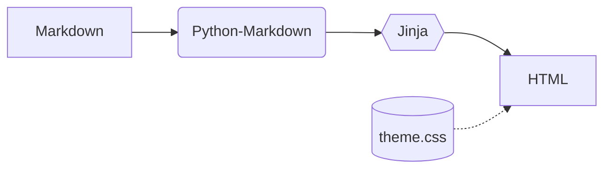
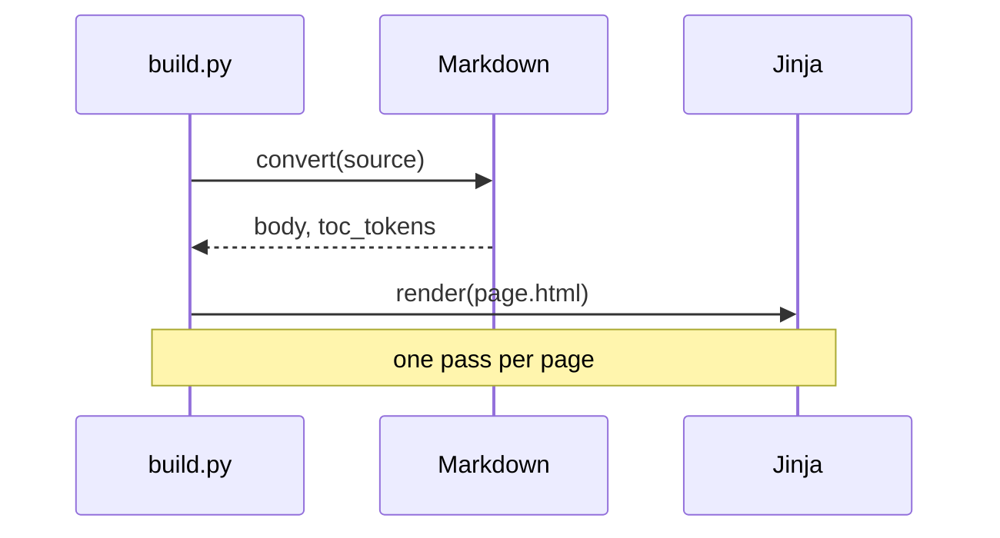

# Sample page

Every building block of the theme on one page. The text is set in Inter at 15px with a line height of 1.8;
links look [like this](guide/index.html), inline code like `make build`, keys like <kbd>Ctrl</kbd>+<kbd>C</kbd>,
and <mark>marked text</mark> like this.

日本語の段落は BIZ UDPGothic で組まれる。英字の `Inter` と混ぜても、行の高さは変わらない。

## Headings

The page's own h2 carries an accent edge on the left. The permalink (¶) shows on hover.

### Third level

Third-level headings stay plain.

#### Fourth level

The fourth level is set at the body size, in bold.

## Lists

- Unordered lists indent by 1.25em
    - and nest by 0.625em
    - with 0.5em between items
- A second item

Ordered lists keep their numbers:

1. Ordered lists
2. use the same spacing

> A quote is set in the lighter text colour, with a rule on its left.

## Table

| token | value | role |
|---|---|---|
| `--dt-default-bg-color` | `#f7f8fa` | ground |
| `--dt-default-fg-color` | `#24282e` | text |
| `--dt-accent-fg-color` | `#2f6bff` | focus, current item |
| `--dt-typeset-a-color` | `#1f5ad6` | links |

## Code

```python hl_lines="5"
from pathlib import Path


def build(src: Path) -> str:
    text = src.read_text(encoding="utf-8")  # highlighted line
    return markdown.markdown(text, extensions=["toc"])
```

```bash
uv run python build.py && open dist/index.html
```

## Admonitions

!!! note
    The default type. Write `!!! <type> "Title"` for a custom title.

!!! tip "Custom title"
    Each type has its own colour and Lucide icon.

!!! warning
    Watch out.

!!! danger
    Do not.

??? example "Collapsible (pymdownx.details)"
    Hidden until opened. Use `???+` to start it open.

## Diagrams





## Image


